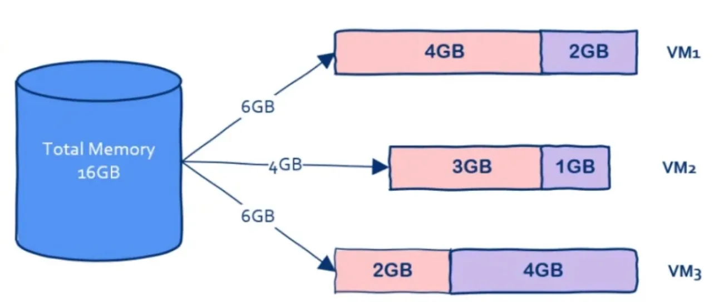
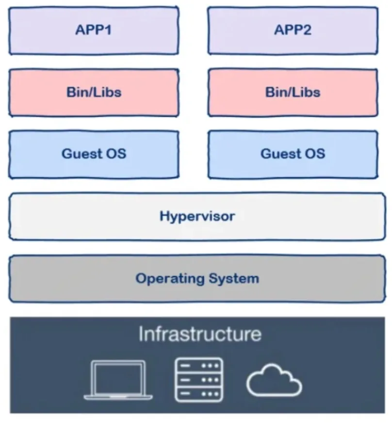
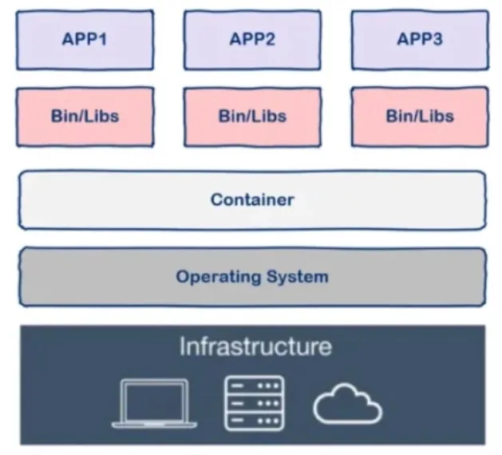
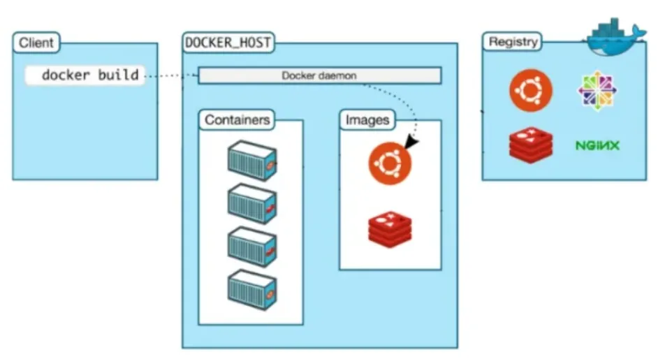
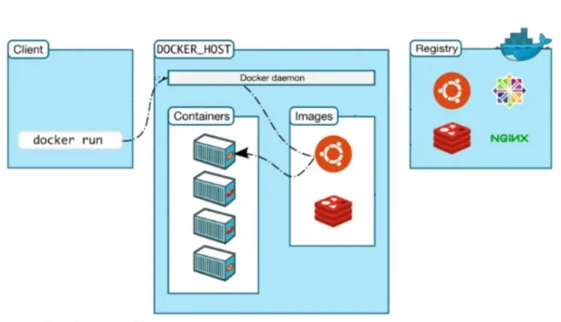
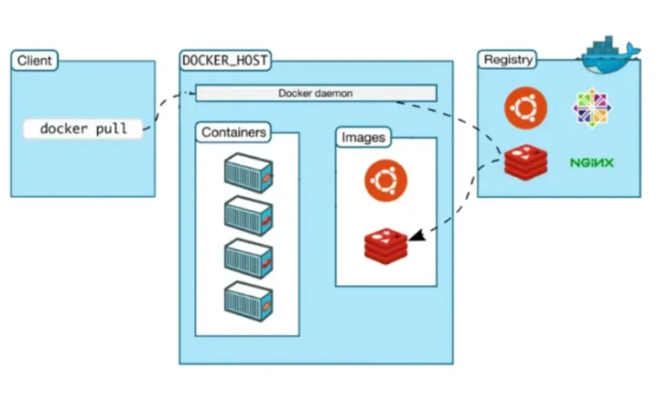

## Introduction

Assuming your company is secretly developing the next "Today's Headlines" app, let's call it "Tomorrow's Headlines". The programmers themselves built an environment from scratch to start coding. After finishing the code, the programmers have to hand it over to the testing team. At this point, the testing team starts building the same environment from scratch. If any issues arise during testing, the programmers can innocently say, "It worked perfectly fine in my environment."

Once the testing is done, the operations team has to rebuild the entire environment from scratch. After putting in a lot of effort, they start the deployment, but unfortunately, the system crashes. At this point, the resilient programmers can once again showcase their acting skills and say, "It worked perfectly fine in my environment."

From this entire process, we can see that not only do we repeat the process of building three separate environments, but we also force the programmers to become actors, wasting their talent. It's a typical waste of time and efficiency. Smart programmers are never satisfied with the current situation, which brings us to the time when programmers change the world - the emergence of container technology.

Some may say, "Wait, let's not change the world just yet. We have virtual machines, and VMware is incredibly useful. We can build a virtual machine environment and then replicate it for testing and operations, right?"

Before container technology, this was indeed a good solution, but it wasn't perfect.

Let's first understand that the underlying foundation of cloud computing is virtual machine technology. Cloud computing providers buy a bunch of hardware to build data centers and then use virtual machine technology to divide the hardware resources. For example, they can divide it into 100 virtual machines and sell them to many users.

You might wonder why this solution isn't ideal.

## Virtual Machines vs. Containers

We know that compared to a simple application, an operating system is a heavy and clumsy program, abbreviated as heavyweight. How heavy is it?

We know that running an operating system requires a lot of resources, and we all have deep experience with this. A freshly installed system without any deployments already takes up at least tens of gigabytes of disk space and several gigabytes of memory.

Let's say I have a machine with 16GB of memory and need to deploy three applications. With virtual machine technology, I can divide it like this:

On this machine, three virtual machines are started, with each virtual machine deploying an application. VM1 occupies 2GB of memory, VM2 occupies 1GB of memory, and VM3 occupies 4GB of memory.

We can see that the virtual machines themselves occupy a total of 7GB of memory. Therefore, we cannot allocate more virtual machines to deploy more applications. However, what we deploy are applications, not operating systems, and we need the memory for applications, not the operating system.

Wouldn't it be great if there was a technology that could prevent us from wasting memory on "useless" operating systems? This is the first problem, mainly because the operating system is too heavy.

There is another problem, which is the startup time. We know that restarting the operating system is very slow because the operating system needs to check everything and load everything from scratch. This process is very slow, taking several minutes. Therefore, the operating system is still too slow.

So, is there a technology that can give us the benefits of virtual machines while overcoming these drawbacks and achieving the best of both worlds?

The answer is yes, and that is container technology.

## What is a container?

The term "container" in English also means "shipping container," which is indeed one of the most remarkable inventions in commercial history, significantly reducing the cost of maritime trade. Let's take a look at the benefits of shipping containers:

- Containers are isolated from each other.
- They can be used repeatedly over a long period.
- They allow for quick loading and unloading.
- They have standardized specifications, making them easy to handle at ports and on ships.
- Returning to software containers, the concept is quite similar to that of shipping containers.

One of the main goals of modern software development is isolation, where applications run independently without interfering with each other. Achieving this isolation is not easy. One solution is the virtual machine technology mentioned above, which isolates applications by deploying them on different virtual machines.

However, container technology is different from virtual machine technology in that it only isolates the runtime environment of the application, while containers can share the same operating system. The runtime environment here refers to the various libraries and configurations that the program depends on.

From the figure, we can see that containers are more lightweight and consume fewer resources. Compared to operating systems that often occupy several gigabytes of memory, container technology only requires a few megabytes of space. Therefore, we can deploy a large number of containers on the same hardware, which is incomparable to virtual machines. Moreover, unlike the several minutes it takes for an operating system to start, containers can start almost instantly. Container technology provides a more efficient way to package service stacks. So cool.

So how do we use containers? This brings us to Docker.

Note that containers are a general technology, and Docker is just one implementation of it.

## What is Docker

docker is an open-source project implemented in Go language, which allows us to easily create and use containers. Docker packages the program and all its dependencies into a docker container, so your program will have consistent behavior in any environment. Here, the dependencies of the program running are like containers, and the operating system environment where the containers are located is like a cargo ship or a port. The behavior of the program is only related to the container, not to the cargo ship or the port (operating system).

Therefore, we can see that Docker can abstract away the differences in environments. In other words, once your program is packaged into Docker, its behavior will be consistent regardless of the environment it runs in. Programmers can no longer showcase their talent by saying "it works on my machine," but instead achieve the true goal of "build once, run everywhere."

Another benefit of Docker is fast deployment, which is a common use case in current internet companies. One reason is that containers start up very quickly, and another reason is that as long as the program in a container runs correctly, you can be confident that it will run correctly no matter how many instances are deployed in the production environment.

## How to use Docker

docker has several concepts:

- dockerfile
- image
- container

In fact, you can simply think of an image as an executable program, and a container as a running process.

So, just as writing a program requires source code, "writing" an image requires a dockerfile. The dockerfile is the source code of the image, and Docker is the "compiler".

Therefore, all we need to do is specify in the dockerfile which programs are needed and what kind of configuration is required. Then, we give the dockerfile to the "compiler" Docker for "compilation", which is done using the docker build command. The resulting executable program is the image, and we can then run this image using the docker run command, which creates a Docker container.

Specific usage details are beyond the scope of this message, but you can refer to the official Docker documentation for detailed explanations.

## How docker works

Actually, Docker uses a common CS architecture, which is the client-server model. The Docker client handles various user commands, such as docker build and docker run, while the actual work is done by the server, which is the Docker daemon. It is worth noting that the Docker client and Docker daemon can run on the same machine.

Next, let's use a few commands to explain the workflow of Docker:

### 1, docker build

When we finish writing the dockerfile and hand it over to Docker for "compilation" using this command, the client forwards the request to the Docker daemon, and then the Docker daemon creates an "executable program" image based on the dockerfile.

### 2，docker run

With the "executable program" image, you can now run the program. Next, use the command `docker run`. When the Docker daemon receives this command, it will locate the specific image and load it into memory to start execution. The execution of the image is referred to as a container.

### 3，docker pull

Actually, `docker build` and `docker run` are the two most fundamental commands. Once you know how to use these two commands, you can pretty much start using Docker, the rest is just supplementary.

So, what does `docker pull` mean?

As we mentioned before, the concept of an image in Docker is similar to an "executable program". Where can we download pre-written applications from? It's simple, from the APPStore, the application store. Similarly, since an image is also a type of "executable program", is there a "Docker image Store"? The answer is yes, and it's called Docker Hub, the official "application store" for Docker. You can download pre-written images from here, so you don't have to write your own Dockerfile.

`docker registry` is used to store various images, and the Docker Hub is a public repository where anyone can download images. So, how do we download an image from Docker Hub? That's where the `docker pull` command comes in.

Therefore, the implementation of this command is quite simple. The user sends the command through the Docker client, the Docker daemon receives the command, and then sends a request to the Docker registry to download the image. Once downloaded, it is stored locally, and then we can use the image.

Finally, let's take a look at the underlying implementation of Docker.

## The underlying implementation of Docker

docker is implemented based on the following features provided by the Linux kernel:

- NameSpace

  We know that resources like PID, IPC, and network in Linux are global. However, the NameSpace mechanism is a resource isolation solution where these resources are no longer global but belong to a specific NameSpace. Resources in different NameSpaces do not interfere with each other, making each NameSpace appear as an independent operating system. However, NameSpace alone is not enough.

- Control groups

  Although NameSpace technology enables resource isolation, processes can still access system resources without control, such as CPU, memory, disk, and network. To control process access to resources within a container, Docker uses control groups technology (also known as cgroups). With cgroups, you can control the resource consumption of processes in a container, such as limiting memory usage or specifying which CPUs to run on.

With these two technologies, containers truly resemble independent operating systems.

## Summary

Docker is a very popular technology at present, and many companies are using it in production environments. However, the underlying technology that Docker relies on has actually appeared a long time ago. Now it has been revitalized in the form of Docker and can solve the problems faced very well. I hope this article can help you understand Docker.
